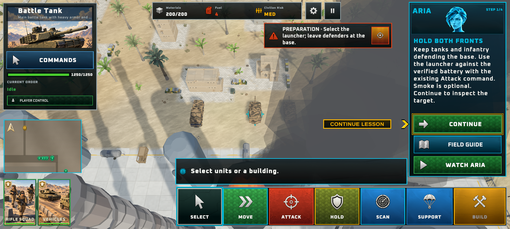

# Board 6 · Selection and target markers

The owner approved the [Board 6 mockup](../../selection-target-markers.png) as the visual direction on November 20, 2026. The production art uses signed-distance shapes on ground quads. The shader draws a 3.5 px stroke and 1.5 px dark keyline at 1080p when there is enough space between strokes.

| Approved mockup | Native gameplay |
| --- | --- |
|  |  |

## Native evidence

The frames below are from the original Board 6 run. The follow-up adjusted the selection shader to sample the quad’s UVs and limit coverage outside the ring and ticks. Its first capture launch stopped at a Unity startup dialog after a C# compilation error. The source correction and revised visuals await native validation. [Follow-up evidence](../../../../Orchestration/windows_dev_results/2026-11-20-ui-c-selection-markers.md#board-6-follow-up)

| State | 1920×1080 | 2400×1080 |
| --- | --- | --- |
| Infantry selected | [Frame](./en-1920x1080-infantry-selected.png) | [Frame](./en-2400x1080-infantry-selected.png) |
| Vehicle selected | [Frame](./en-1920x1080-vehicle-selected.png) | [Frame](./en-2400x1080-vehicle-selected.png) |
| Large unit selected | Missing | Missing |
| Zoom in and out | Missing | Missing |
| Attack preview and accepted | Missing | Missing |
| Move accepted | [Frame](./en-1920x1080-move-accepted.png) | [Frame](./en-2400x1080-move-accepted.png) |

The infantry mark looks filled at the captured camera distance in both 1920×1080 runs. The isolated EditMode render resolved an open centre. Both Move orders were accepted through touch. The green endpoint is partly visible beside a tank at 1920×1080, and the tank obscures it at 2400×1080. Launcher selection stalled in both aspect ratios, so the large-unit, zoom and Attack states remain unverified. Capture attempts and their first failures are listed in the [validation note](../../../../Orchestration/windows_dev_results/2026-11-20-ui-c-selection-markers.md).

## Intentional differences

- The cyan ring is continuous and uses four fixed ticks. Its proportions follow the selected unit's footprint.
- Move uses an open diamond and two chevrons at the accepted destination. The existing order path and its rendering determine any route decoration.
- Attack uses four brackets and a centre pip in both preview and accepted feedback. Preview retains its lower opacity. The projection cap keeps the complete Attack quad within 20% of viewport height, measured along its longest projected span.
- The native captures use separate command states with the production HUD and mission camera. The mockup combines the three glyphs for comparison.
- Live markers come from world presentation. The HUD marker preview remains hidden during gameplay.

## Art assets

- `Assets/Game/Rendering/Shaders/TacticalMarker.shader`
- `Assets/Game/Rendering/Materials/Selection/TacticalMarkerSelection.mat`
- `Assets/Game/Rendering/Materials/Selection/TacticalMarkerMove.mat`
- `Assets/Game/Rendering/Materials/Selection/TacticalMarkerAttack.mat`
- `Assets/Game/Resources/TacticalMarkerAttackTarget.mat`

Real-player and device acceptance are pending.
