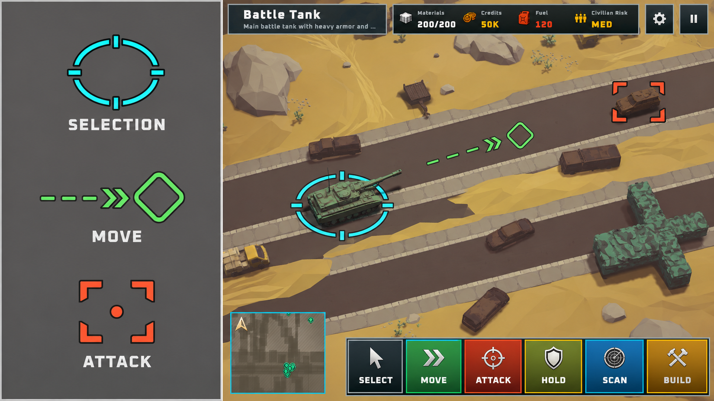

# Board 6 · Selection and target markers

The owner approved the [Board 6 mockup](../../selection-target-markers.png) as the visual direction on November 20, 2026. The production art uses signed-distance shapes on ground quads. The shader draws a 3.5 px stroke and 1.5 px dark keyline at 1080p when there is enough space between strokes.

| Approved mockup | Native gameplay |
| --- | --- |
|  |  |

## Native evidence

Follow-up 3 schedules Move while the tank is selected and aims for open sand east of the refinery. The fixture reads the saved frame and publishes the eight-frame result separately from its input loop. The lab hit Unity’s scene-recovery dialog before compilation, so both widths and the ARIA regression await validation. The frames below are from earlier runs. [Follow-up 3 results](../../../../Orchestration/windows_dev_results/2026-11-20-ui-c-selection-markers.md#board-6-follow-up-3)

The lab captured seven EN states at 1920×1080 with the revised infantry mesh and zoom fixture. An earlier attempt captured Move and failed the eight-frame gate. The retry stopped before publishing the gate result. The 2400×1080 column contains evidence from the original Board 6 build. [Follow-up 2 evidence](../../../../Orchestration/windows_dev_results/2026-11-20-ui-c-selection-markers.md#board-6-follow-up-2)

| State | 1920×1080 follow-up 2 | 2400×1080 original |
| --- | --- | --- |
| Infantry selected | [Frame](./en-1920x1080-infantry-selected.png) | [Frame](./en-2400x1080-infantry-selected.png) |
| Vehicle selected | [Frame](./en-1920x1080-vehicle-selected.png) | [Frame](./en-2400x1080-vehicle-selected.png) |
| Launcher selected | [Frame](./en-1920x1080-large-unit-selected.png) | Pending |
| Zoom in and out | [In](./en-1920x1080-zoom-in.png), [out](./en-1920x1080-zoom-out.png) | Pending |
| Attack preview and accepted | [Preview](./en-1920x1080-attack-preview.png), [accepted](./en-1920x1080-attack-accepted.png) | Pending |
| Move accepted | [Earlier attempt](./en-1920x1080-move-accepted.png) | [Frame](./en-2400x1080-move-accepted.png) |

The infantry frame shows an open cyan centre at nominal zoom. The launcher was selected by a normal touch at the displayed world target. The two zooms used the production camera requests from the fixture because the HUD touch could not reach a zoom control. The refinery obscures the Move destination in the earlier frame. The Attack preview shows the cyan guide prominently. The accepted frame shows the target brackets and centre pip alongside the missile impact-area circle. [`SplitFrontLauncherHudView`](../../../../../Assets/Game/Scripts/UI/Screens/SplitFrontLauncherHudView.cs) renders that circle from the launcher’s configured damage radius, which also drives area damage.

## Intentional differences

- The cyan ring is continuous and uses four fixed ticks. Its proportions follow the selected unit's footprint.
- Move uses an open diamond and two chevrons at the accepted destination. The existing order path and its rendering determine any route decoration.
- Attack uses four brackets and a centre pip in both preview and accepted feedback. Preview retains its lower opacity. The projection cap keeps the complete Attack quad within 20% of viewport height, measured along its longest projected span.
- The native captures use separate command states with the production HUD and mission camera. The mockup combines the three glyphs for comparison.
- Live markers come from world presentation. The HUD marker preview remains hidden during gameplay.

## Art assets

- `Assets/Game/Rendering/Shaders/TacticalMarker.shader`
- `Assets/Game/Rendering/Meshes/Selection/Tactical_InfantryRing.asset`
- `Assets/Game/Rendering/Materials/Selection/TacticalMarkerSelection.mat`
- `Assets/Game/Rendering/Materials/Selection/TacticalMarkerMove.mat`
- `Assets/Game/Rendering/Materials/Selection/TacticalMarkerAttack.mat`
- `Assets/Game/Resources/TacticalMarkerAttackTarget.mat`

Real-player and device acceptance are pending.
