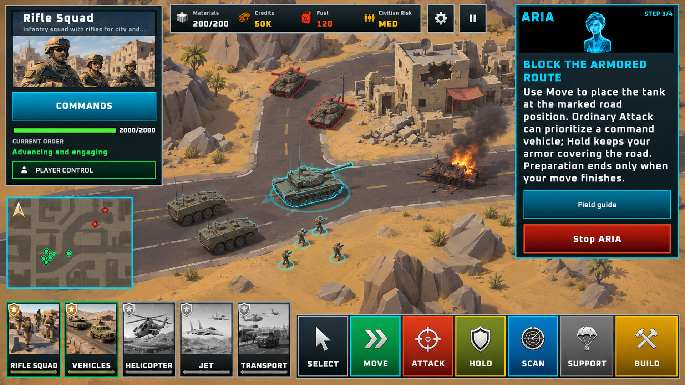
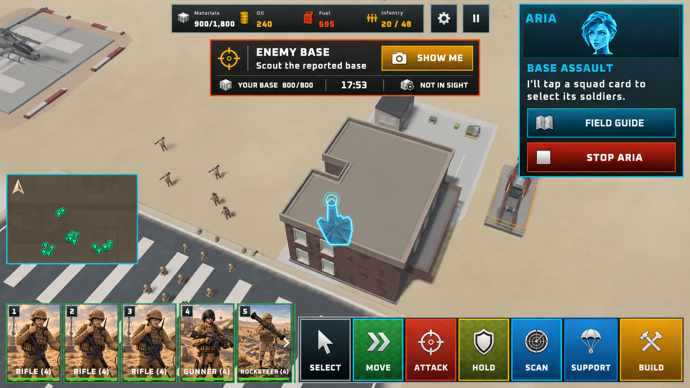
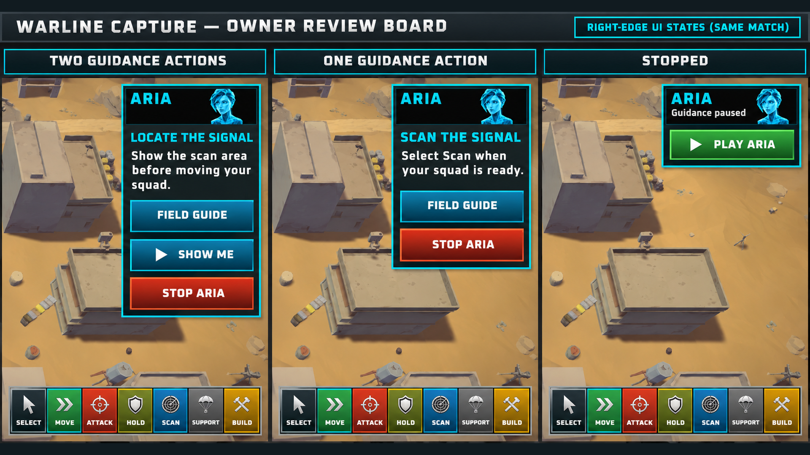
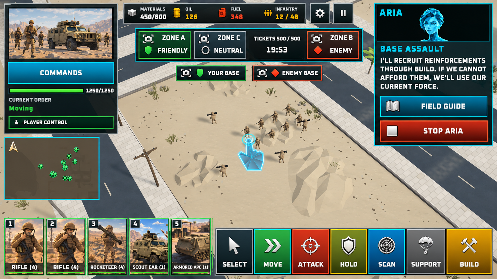
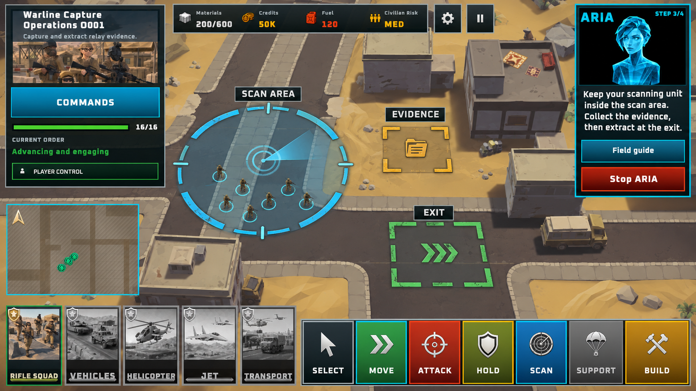
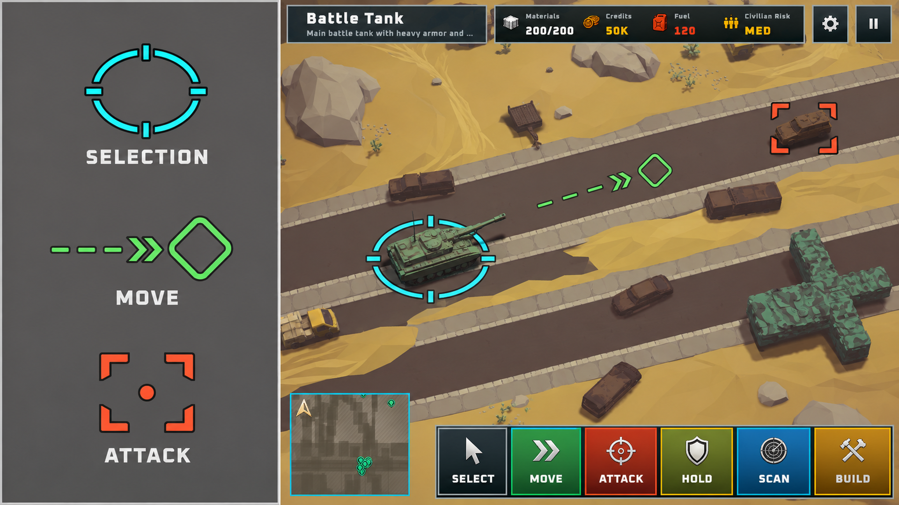

# Match UI polish — owner visual-direction review

Generated with Codex built-in ImageGen for owner review on 2026-11-20. Each board has one 1920×1080 after PNG with its exact prompt beside it. The ARIA comparison has slim top and bottom margins to preserve the proportions of the generated panels. The six approval numbers at the end apply to the visual proposals.

**References.** The Steel Push Campaign HUD governs square typography, framing, portraits and native command colors. The approved Operations boards establish the compact objective-card direction and review format. [Native Campaign HUD](../CH04M02SteelPush/VisualReview/en-hud-aria-5.png) · [Operations review](../OperationsMockups/review.md) · [O002 board](../OperationsMockups/o002-escort-hud-v01.png) · [O003 board](../OperationsMockups/o003-repair-hud-v01.png) · [O005 board](../OperationsMockups/o005-rescue-hud-v01.png)

**Inspected.** Archived Skirmish opening, setup and terminal images across Base Assault (BA), Frontline Control (FC), Breakthrough (BT) and Convoy Escort (CE), including Desert Base, City Crossroads and Mountain Pass. The sampled setup and terminal-return screens provided mission and map context. Gameplay crops below come from opening, active match or native prefab captures, as identified per image. Padding and stroke values are proposed pixels on a 1920×1080 reference canvas. Hex values are proposed accents unless described as existing.

**Review progress.** The archive and six mockups were visually inspected. Owner visual-direction approval is pending. Automated Unity checks, implemented native-screen review, normal-input missions through ARIA, result and return, and real player/device acceptance are pending.

## 1. Left panel spacing

**Problem.** The selected-unit card, minimap and bottom cards have inconsistent gutters, with collisions in tight layouts.

**Before**

- [Before 1](./left-panels-spacing-before-1.png) — Static native HUD prefab capture with the selection wheel open. The minimap runs behind the selection panel, the card sits 8 px above the category row, and the bottom action background overlaps the rightmost category cards. [Source Design/AgentReports/ComicPortraitMigration/NativeHud/warline-selection-wheel-en.png](../ComicPortraitMigration/NativeHud/warline-selection-wheel-en.png)
- [Before 2](./left-panels-spacing-before-2.png) — Native O001 live HUD context. The selection card, minimap and category cards have visibly different vertical gaps. The bottom safe margin is about 15 px. [Source Design/AgentReports/Operations/O001_PLAYER_EXPERIENCE_20260924/evidence/victory-02/O001ActiveScan.png](../Operations/O001_PLAYER_EXPERIENCE_20260924/evidence/victory-02/O001ActiveScan.png)

**After** · [Exact ImageGen prompt](./left-panels-spacing.prompt.txt)

- **Changes.** Align the selection card, minimap and first category card to a 16 px left safe inset. Use 24 px between selection card and minimap and between minimap and categories, 8 px between categories, at least 12 px to the command strip and 16 px beneath both rows. Give the unit card 16 px internal padding, 12 px between sections and a Commands target at least 64 px high. Retain the existing cyan minimap dock border (`#00C6EB`) and Campaign command colors.
- **Known deviations.** The generated gaps and portrait proportions vary from the spec. The mockup borrows Campaign resource labels and ARIA text. The native prefab capture demonstrates the overlap in a preview state. The live O001 frame documents spacing variance with the panels separated.
- **Likely implementation · M.** `SCN08_MatchHudContent.prefab`, `MissionHudTouchLayoutView.RefreshLayout`, `MatchHudSelectionPanelView.ContentSize.cs`, `MatchHudSquadTrayView.Pagination.cs` and relevant `MatchHudV3PrefabBuilder` layout. Check tall selection content and the paginated roster against the same safe area.

## 2. Centre information panels

**Problem.** Skirmish objective data spreads across wide modules with competing emphasis and, in some openings, a second instruction bar.

**Before**

- [Before 1](./centre-info-panels-before-1.png) — S002 BA, Desert Base. Wide objective strip with separate base blocks and a dedicated clock. [Source Design/AgentReports/SkirmishExpansion/S002/_Evidence/s002-aria-live-104731-en-94608392895243fc89013cdc70f711fc.jsonl.opening.png](../SkirmishExpansion/S002/_Evidence/s002-aria-live-104731-en-94608392895243fc89013cdc70f711fc.jsonl.opening.png)
- [Before 2](./centre-info-panels-before-2.png) — S026 BA, City Crossroads, 2400×1080 source. An instruction bar stacks under the objective strip, with a world-anchored rendezvous chip below and to the right. [Source Design/AgentReports/SkirmishExpansion/S026/_Evidence/s026-aria-live-104729-en-0ba459be9313476eb88d1893ae6ec456.jsonl.opening.png](../SkirmishExpansion/S026/_Evidence/s026-aria-live-104729-en-0ba459be9313476eb88d1893ae6ec456.jsonl.opening.png)
- [Before 3](./centre-info-panels-before-3.png) — S056 FC, Mountain Pass. Three identically styled zone controls flank tickets and time. [Source Design/AgentReports/SkirmishExpansion/S056/_Evidence/s056-aria-live-130365-en-192f3587471a43499cb6464162acb95a.jsonl.opening.png](../SkirmishExpansion/S056/_Evidence/s056-aria-live-130365-en-192f3587471a43499cb6464162acb95a.jsonl.opening.png)
- [Before 4](./centre-info-panels-before-4.png) — S041 BT, City Crossroads. Corridor names extend past the blue card frames. [Source Design/AgentReports/SkirmishExpansion/S041/_Evidence/s041-aria-live-104731-en-8996003142354b48ba0b0846c74c619c.jsonl.opening.png](../SkirmishExpansion/S041/_Evidence/s041-aria-live-104731-en-8996003142354b48ba0b0846c74c619c.jsonl.opening.png)
- [Before 5](./centre-info-panels-before-5.png) — S046 CE, City Crossroads. Destination and supply share the wide blue treatment, and the Materials value crosses the bottom frame. [Source Design/AgentReports/SkirmishExpansion/S046/_Evidence/s046-aria-live-104731-en-62d7bebd88d848a6a67ca339ff006d4e.jsonl.opening.png](../SkirmishExpansion/S046/_Evidence/s046-aria-live-104731-en-62d7bebd88d848a6a67ca339ff006d4e.jsonl.opening.png)

**After** · [Exact ImageGen prompt](./centre-info-panels.prompt.txt)

- **Changes.** Use one charcoal card, targeting 560 × 106 px for the English BA example, 12 px below resources and with 16 px internal padding. Use a 2–3 px warm keyline (`#E7562C`), an amber objective glyph and a gold camera action at least 64 px tall. Surface purpose and next action first, then timer and essential status. The other families can use the same hierarchy for tickets and zones, corridors and exit, or convoy progress. Keep Show Me and the existing base/goal focus paths camera-only.
- **Known deviations.** The generated card is wider and taller than the target. The proposal illustrates BA and one visible camera action. Existing localized copy, context-dependent base-focus access, fog-of-war status, timers and objective-family progress are authoritative. Roster artwork and map details are illustrative.
- **Likely implementation · M.** `SkirmishMatchView.cs` builds `BaseObjectives`. `SkirmishMatchView.PublicObjectiveHud.cs` binds family controls and scores, `SkirmishMatchView.Clock.cs` owns the clock, and `SkirmishMatchView.MissionGuidance.cs` supplies the guidance row. Reuse the native threat presentation vocabulary from `MatchHudThreatVisibilityView.cs` and the shared HUD prefab.

## 3. ARIA panel states

**Problem.** ARIA can reserve empty dark space, lose its guidance/toggle, or leave a bare control in some reported states.

**Before**

- [Before 1](./aria-panel-states-before-1.png) — Static native prefab capture with an empty black portrait region and empty body. [Source Design/AgentReports/ComicPortraitMigration/NativeHud/warline-selection-wheel-en.png](../ComicPortraitMigration/NativeHud/warline-selection-wheel-en.png)
- [Before 2](./aria-panel-states-before-2.png) — Early O001 native match capture. The right rail has a portrait shell without a guidance body or Play / Stop control. [Source Design/AgentReports/Operations/O001_Integration_20260922/manual-victory-1102/009.png](../Operations/O001_Integration_20260922/manual-victory-1102/009.png)
- [Before 3](./aria-panel-states-before-3.png) — O001 stopped-state context. ARIA Play remains inside the taller checklist rail with the preceding guidance still visible. [Source Design/AgentReports/Operations/O001_PLAYER_EXPERIENCE_20260924/evidence/victory-02/O001AriaStopped.png](../Operations/O001_PLAYER_EXPERIENCE_20260924/evidence/victory-02/O001AriaStopped.png)

**Archive gap.** No inspected capture shows an unlabeled standalone ARIA button. The after board covers that reported case by keeping the labeled toggle inside the panel.

**After** · [Exact ImageGen prompt](./aria-panel-states.prompt.txt)

- **Changes.** Active with two actions shows Field Guide and Show Me above red Stop ARIA. Active with one action immediately stacks Stop beneath the single Field Guide. Stopped has a short ARIA header, status and green Play ARIA. Size the panel from content, with 16 px outer and inner insets, 12 px vertical gaps, 64 px minimum button height and the cyan `#00B2CF` accent. Show Me keeps its camera-only behavior.
- **Known deviations.** The board headings and repeated HUD crops are review framing. The generated Show Me uses a play triangle. Use the native camera-focus glyph and localized action labels. The example guidance is illustrative. The brief/coach countdown and action eligibility stay governed by the match.
- **Likely implementation · M.** `SCN08_MatchHudContent.prefab` binds `AriaTutorialBriefingView`. Inspect its `.Layout.cs`, `.Actions.cs` and `.ButtonIcons.cs` partials, `MatchHudAssistantUiSystemHelper.PresentationLifecycle.cs`, and the O001 rail in `OperationsMissionScreenView.cs`. Keep Play / Stop available through guidance changes.

## 4. HUD colour consistency

**Problem.** Ownership styling varies between match HUD versions, and S011 wraps NEUTRAL into NEUTRA / L.

**Before**

- [Before 1](./hud-colour-consistency-before-1.png) — S011 FC opening, Desert Base. All three blue zone cards visibly split NEUTRAL. [Source Design/AgentReports/SkirmishExpansion/S011/_Evidence/s011-aria-live-155923-en-db27ac54dcf3429bb2ee337adca5d311.jsonl.opening.png](../SkirmishExpansion/S011/_Evidence/s011-aria-live-155923-en-db27ac54dcf3429bb2ee337adca5d311.jsonl.opening.png)
- [Before 2](./hud-colour-consistency-before-2.png) — Archived native building-selection capture. YOUR BASE and ENEMY BASE use the same cyan treatment. [Source Design/AgentReports/SkirmishBuildingSelection/barracks-selected.png](../SkirmishBuildingSelection/barracks-selected.png)

The S026 BA capture in board 2 already shows green and red base buttons. Extend that semantic distinction to shared displays and zone ownership.

**After** · [Exact ImageGen prompt](./hud-colour-consistency.prompt.txt)

- **Changes.** Pair friendly green `#49BD62` with a filled shield, enemy red-orange `#F45C3B` with a diamond, and neutral silver `#BBC7CD` with a hollow ring. Use dark surfaces, 12 px card gaps and internal side insets, and at least 64 px tall targets. Give ownership the full width on its own line, size for localized text, and place the camera icon on the title line. Keep contested and capture-progress information available in compact status space.
- **Known deviations.** This palette sampler deliberately shows all three ownership states at once, and shows base chips alongside FC cards so the owner can compare them. In the game, use the relevant mode’s data and controls, including its base health or knowledge state. The inserted selection card and ownership during the opening are concept content.
- **Likely implementation · M.** `SkirmishMatchView.PublicObjectiveHud.cs` owns zone controls and ownership strings. `SkirmishMatchView.cs` and `.Observation.cs` own base controls and in-world base status. `HudIconButtonView.cs` supplies role styling and icon/label geometry. `V3UiLocalizationCatalogBuilder.cs` is a touch point if localized wording changes.

## 5. Operations ground markers

**Problem.** O001’s plain scan ring and projected objective labels provide little shape or material distinction between steps.

**Before**

- [Before 1](./operations-ground-markers-before-1.png) — O001 active scan. The objective is a thin blue circle with a rectangular progress label over the world. [Source Design/AgentReports/Operations/O001_PLAYER_EXPERIENCE_20260924/evidence/victory-02/O001ActiveScan.png](../Operations/O001_PLAYER_EXPERIENCE_20260924/evidence/victory-02/O001ActiveScan.png)
- [Before 2](./operations-ground-markers-before-2.png) — O001 extraction. The visible EXTRACTION label and cyan guidance pointer identify the location without a ground perimeter. [Source Design/AgentReports/Operations/O001_PLAYER_EXPERIENCE_20260924/evidence/victory-02/O001AriaLatest.png](../Operations/O001_PLAYER_EXPERIENCE_20260924/evidence/victory-02/O001AriaLatest.png)
- [Before 3](./operations-ground-markers-before-3.png) — Older O001 native capture during relay recovery. The EVIDENCE control and RECOVER 14/15 s state are visible. The ground below is clear of a readable evidence decal. [Source Design/AgentReports/Operations/O001_Integration_20260922/manual-victory-1102/012.png](../Operations/O001_Integration_20260922/manual-victory-1102/012.png)

**Archive gap.** The inspected native evidence-phase frames do not isolate a standalone evidence ground marker. The evidence treatment on the after board is a proposal.

**After** · [Exact ImageGen prompt](./operations-ground-markers.prompt.txt)

- **Changes.** Use terrain-conforming marks with blue `#35A9E7` segmented radar arcs and four ticks for scan, gold `#E7AA30` corners and an intel glyph for evidence, and green `#51C46B` broken corners and egress chevrons for extraction. Target 3–4 px bright strokes at nominal zoom with a dark keyline and restrained fill. Use 12 px label padding and 16 px minimum label-to-label clearance. Preserve authored scan radius, exposure timing and phase-specific marker visibility.
- **Known deviations.** The marks are adjacent for comparison and the generated scan footprint has a heavier fill and stroke than specified. The sample says EXIT and invents some header data. Use the localized native label, checklist, progress and actual objective anchors in game.
- **Likely implementation · L.** `OperationsMissionPresentationSystem.cs` projects actual O001 sites, evidence and exit. `OperationsMissionScreenView.cs` owns the projected labels and recover overlay. `OperationsScanAreaGraphic.cs` draws the current ring. `TacticalGroundMarkerView.cs` is an existing Campaign renderer to evaluate for reuse with O001’s visibility and radius inputs. Work includes designing marker art and checking terrain readability at game camera distances.

## 6. Selection and target markers

**Problem.** Existing selection, destination and attack feedback can read as similar circles or overwhelm units at RTS camera height.

**Before**

- [Before 1](./selection-target-markers-before-1.png) — O001 native infantry selection rings. Their cyan edges are similar to the active scan perimeter around the group. [Source Design/AgentReports/Operations/O001_PLAYER_EXPERIENCE_20260924/evidence/victory-02/O001ActiveScan.png](../Operations/O001_PLAYER_EXPERIENCE_20260924/evidence/victory-02/O001ActiveScan.png)
- [Before 2](./selection-target-markers-before-2.png) — Native ordinary-move evidence. The cyan concentric destination ping and cyan unit selection ring share shape and color. [Source Design/AgentReports/SupportSystem/Evidence/SmokeJourney/20260928-201007-en-paratroopers/paratrooper-ordinary-move.png](../SupportSystem/Evidence/SmokeJourney/20260928-201007-en-paratroopers/paratrooper-ordinary-move.png)
- [Before 3](./selection-target-markers-before-3.png) — Native Split Front attack preparation. The red launcher targeting ring occupies a large portion of the visible terrain. [Source Design/AgentReports/CH04M03SplitFront/Evidence/20260929-233241-split-front-en-smoke/en-launcher-attack-preparing.png](../CH04M03SplitFront/Evidence/20260929-233241-split-front-en-smoke/en-launcher-attack-preparing.png)

**After** · [Exact ImageGen prompt](./selection-target-markers.prompt.txt)

- **Changes.** Use a footprint-sized cyan selection ring with four ticks (`#36D8E4`), a green open-diamond Move endpoint with two chevrons (`#55CF62`), and a red-orange four-bracket Attack reticle with a centre pip (`#FF5536`). At nominal zoom target 3–4 px main strokes and a 1–2 px dark keyline. Scale to footprints and camera zoom. Keep the selection mark persistent and command feedback tied to its existing preview and accepted-order lifetimes.
- **Known deviations.** The in-context comparison deliberately shows all three markers at once. Their strokes and footprint are exaggerated, and the Attack pip shown on the left sheet is omitted in the right view. Selection samples use different arc counts than the prompt. The native gameplay crop supplies context for reviewing the shapes.
- **Likely implementation · L.** `VehicleSelectionMarker.prefab`, `PremiumWorldSelectionFrameView.cs`, `SelectionHudFeedbackUiSystemHelper.cs`, `Target_Move.prefab`, `Target_Attack.prefab` and `AttackTargetSelectionMarker.prefab`. `SelectionOrderMarkerPresentationSystemHelper.cs` owns world-marker placement and lifetime. Check the parallel feedback path in `SelectionScreenMarkerUiSystemHelper.cs` so the two layers agree.

Status: owner approved all six boards for implementation on 2026-11-20 ("Approve all six"). Visual direction only, not implementation evidence. Native-screen review, ARIA regression journeys and device acceptance are tracked separately.

## Owner approval

Reply with the board numbers you approve, for example `approve 1,3,5`. Add a note beside any board you want revised.

1. Left panel spacing
2. Centre information panels
3. ARIA panel states
4. HUD colour consistency
5. Operations ground markers
6. Selection and target markers
