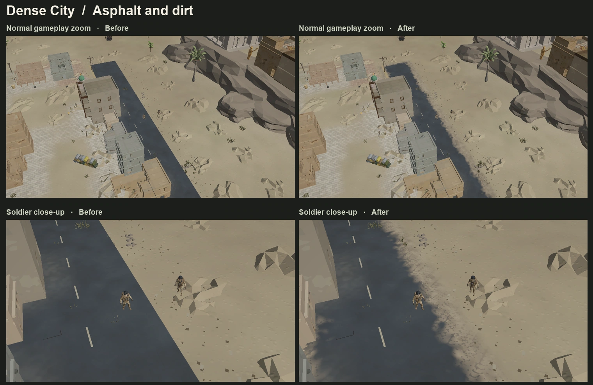
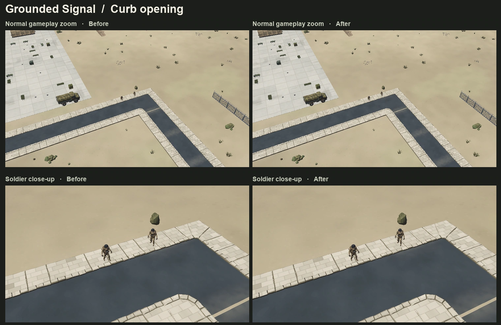
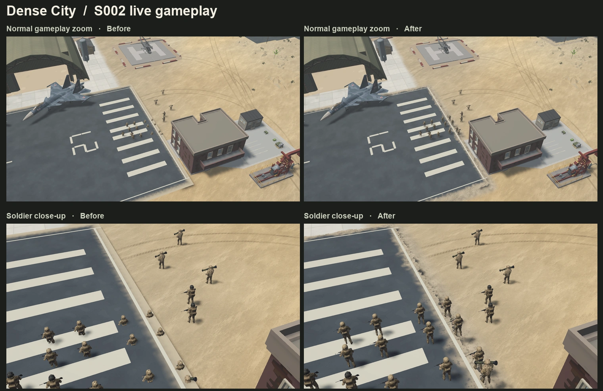

# Road edges and sidewalks

The camera, lighting and infantry positions match within each pair. The 14 map presentations use the gameplay lens and angle. The map survey uses two posed game infantry with their lowest skinned vertices placed on the rendered surface. The live S002 comparison uses spawned soldiers. The normal view is at 44 m.

[Dense City sidewalk at the intersection](restored-sidewalk.webp) · [Trust Under Fire bridge joint](bridge-comparison.webp)

## Live S002 gameplay

These views use the same friendly infantry spawn in two runs of S002 with seed 104731. Each pair was captured with the simulation paused. The original and corrected builds use the same camera position. The runway and sand samples in [foot-contact.csv](foot-contact.csv) record the draw-model offset and measured sole contact for each soldier.

At the S002 spawn, 15 soldiers stood on the raised runway and 5 stood on adjacent sand. The deepest original sole was 1.48 m below the drawn surface. After the fix, the largest measured contact error across these soldiers was 0.00 cm. The game still uses its original unit positions for movement and combat.

[See the settled in-game camera after the rifleman switches detail levels](player-camera-soldiers.webp). Both repaired distance meshes use fewer triangles than their original limits.

## All 14 map presentations

Open `index.html` from a local checkout for the side-by-side viewer. Each link below opens a full-size capture.

| Map | Asphalt and dirt at normal zoom | Asphalt and dirt at soldier zoom | Sidewalk at normal zoom | Sidewalk at soldier zoom |
| --- | --- | --- | --- | --- |
| Dense City | [Before](frames/DenseCity-shoulder-normal-before.webp) · [After](frames/DenseCity-shoulder-normal-after.webp) | [Before](frames/DenseCity-shoulder-soldiers-before.webp) · [After](frames/DenseCity-shoulder-soldiers-after.webp) | [Before](frames/DenseCity-sidewalk-normal-before.webp) · [After](frames/DenseCity-sidewalk-normal-after.webp) | [Before](frames/DenseCity-sidewalk-soldiers-before.webp) · [After](frames/DenseCity-sidewalk-soldiers-after.webp) |
| City Edge Airfield | [Before](frames/CityEdgeAirfield-shoulder-normal-before.webp) · [After](frames/CityEdgeAirfield-shoulder-normal-after.webp) | [Before](frames/CityEdgeAirfield-shoulder-soldiers-before.webp) · [After](frames/CityEdgeAirfield-shoulder-soldiers-after.webp) | [Before](frames/CityEdgeAirfield-sidewalk-normal-before.webp) · [After](frames/CityEdgeAirfield-sidewalk-normal-after.webp) | [Before](frames/CityEdgeAirfield-sidewalk-soldiers-before.webp) · [After](frames/CityEdgeAirfield-sidewalk-soldiers-after.webp) |
| Ash Line Port | [Before](frames/AshLinePort-shoulder-normal-before.webp) · [After](frames/AshLinePort-shoulder-normal-after.webp) | [Before](frames/AshLinePort-shoulder-soldiers-before.webp) · [After](frames/AshLinePort-shoulder-soldiers-after.webp) | [Before](frames/AshLinePort-sidewalk-normal-before.webp) · [After](frames/AshLinePort-sidewalk-normal-after.webp) | [Before](frames/AshLinePort-sidewalk-soldiers-before.webp) · [After](frames/AshLinePort-sidewalk-soldiers-after.webp) |
| Refinery District | [Before](frames/RefineryDistrict-shoulder-normal-before.webp) · [After](frames/RefineryDistrict-shoulder-normal-after.webp) | [Before](frames/RefineryDistrict-shoulder-soldiers-before.webp) · [After](frames/RefineryDistrict-shoulder-soldiers-after.webp) | [Before](frames/RefineryDistrict-sidewalk-normal-before.webp) · [After](frames/RefineryDistrict-sidewalk-normal-after.webp) | [Before](frames/RefineryDistrict-sidewalk-soldiers-before.webp) · [After](frames/RefineryDistrict-sidewalk-soldiers-after.webp) |
| Frontier | [Before](frames/Frontier-shoulder-normal-before.webp) · [After](frames/Frontier-shoulder-normal-after.webp) | [Before](frames/Frontier-shoulder-soldiers-before.webp) · [After](frames/Frontier-shoulder-soldiers-after.webp) | [Before](frames/Frontier-sidewalk-normal-before.webp) · [After](frames/Frontier-sidewalk-normal-after.webp) | [Before](frames/Frontier-sidewalk-soldiers-before.webp) · [After](frames/Frontier-sidewalk-soldiers-after.webp) |
| Desert Base | [Before](frames/DesertBase-shoulder-normal-before.webp) · [After](frames/DesertBase-shoulder-normal-after.webp) | [Before](frames/DesertBase-shoulder-soldiers-before.webp) · [After](frames/DesertBase-shoulder-soldiers-after.webp) | [Before](frames/DesertBase-sidewalk-normal-before.webp) · [After](frames/DesertBase-sidewalk-normal-after.webp) | [Before](frames/DesertBase-sidewalk-soldiers-before.webp) · [After](frames/DesertBase-sidewalk-soldiers-after.webp) |
| Desert Base · staged presentation | [Before](frames/StagedDesertBase-shoulder-normal-before.webp) · [After](frames/StagedDesertBase-shoulder-normal-after.webp) | [Before](frames/StagedDesertBase-shoulder-soldiers-before.webp) · [After](frames/StagedDesertBase-shoulder-soldiers-after.webp) | [Before](frames/StagedDesertBase-sidewalk-normal-before.webp) · [After](frames/StagedDesertBase-sidewalk-normal-after.webp) | [Before](frames/StagedDesertBase-sidewalk-soldiers-before.webp) · [After](frames/StagedDesertBase-sidewalk-soldiers-after.webp) |
| Grounded Signal | [Before](frames/CH04M04GroundedSignal-shoulder-normal-before.webp) · [After](frames/CH04M04GroundedSignal-shoulder-normal-after.webp) | [Before](frames/CH04M04GroundedSignal-shoulder-soldiers-before.webp) · [After](frames/CH04M04GroundedSignal-shoulder-soldiers-after.webp) | [Before](frames/CH04M04GroundedSignal-sidewalk-normal-before.webp) · [After](frames/CH04M04GroundedSignal-sidewalk-normal-after.webp) | [Before](frames/CH04M04GroundedSignal-sidewalk-soldiers-before.webp) · [After](frames/CH04M04GroundedSignal-sidewalk-soldiers-after.webp) |
| Armor Break | [Before](frames/CH04M05ArmorBreak-shoulder-normal-before.webp) · [After](frames/CH04M05ArmorBreak-shoulder-normal-after.webp) | [Before](frames/CH04M05ArmorBreak-shoulder-soldiers-before.webp) · [After](frames/CH04M05ArmorBreak-shoulder-soldiers-after.webp) | [Before](frames/CH04M05ArmorBreak-sidewalk-normal-before.webp) · [After](frames/CH04M05ArmorBreak-sidewalk-normal-after.webp) | [Before](frames/CH04M05ArmorBreak-sidewalk-soldiers-before.webp) · [After](frames/CH04M05ArmorBreak-sidewalk-soldiers-after.webp) |
| Citywide Alert | [Before](frames/CH05M01CitywideAlert-shoulder-normal-before.webp) · [After](frames/CH05M01CitywideAlert-shoulder-normal-after.webp) | [Before](frames/CH05M01CitywideAlert-shoulder-soldiers-before.webp) · [After](frames/CH05M01CitywideAlert-shoulder-soldiers-after.webp) | [Before](frames/CH05M01CitywideAlert-sidewalk-normal-before.webp) · [After](frames/CH05M01CitywideAlert-sidewalk-normal-after.webp) | [Before](frames/CH05M01CitywideAlert-sidewalk-soldiers-before.webp) · [After](frames/CH05M01CitywideAlert-sidewalk-soldiers-after.webp) |
| Trust Under Fire | [Before](frames/CH05M02TrustUnderFire-shoulder-normal-before.webp) · [After](frames/CH05M02TrustUnderFire-shoulder-normal-after.webp) | [Before](frames/CH05M02TrustUnderFire-shoulder-soldiers-before.webp) · [After](frames/CH05M02TrustUnderFire-shoulder-soldiers-after.webp) | [Before](frames/CH05M02TrustUnderFire-sidewalk-normal-before.webp) · [After](frames/CH05M02TrustUnderFire-sidewalk-normal-after.webp) | [Before](frames/CH05M02TrustUnderFire-sidewalk-soldiers-before.webp) · [After](frames/CH05M02TrustUnderFire-sidewalk-soldiers-after.webp) |
| Network Collapse | [Before](frames/CH05M03NetworkCollapse-shoulder-normal-before.webp) · [After](frames/CH05M03NetworkCollapse-shoulder-normal-after.webp) | [Before](frames/CH05M03NetworkCollapse-shoulder-soldiers-before.webp) · [After](frames/CH05M03NetworkCollapse-shoulder-soldiers-after.webp) | [Before](frames/CH05M03NetworkCollapse-sidewalk-normal-before.webp) · [After](frames/CH05M03NetworkCollapse-sidewalk-normal-after.webp) | [Before](frames/CH05M03NetworkCollapse-sidewalk-soldiers-before.webp) · [After](frames/CH05M03NetworkCollapse-sidewalk-soldiers-after.webp) |
| Last Corridor | [Before](frames/CH05M04LastCorridor-shoulder-normal-before.webp) · [After](frames/CH05M04LastCorridor-shoulder-normal-after.webp) | [Before](frames/CH05M04LastCorridor-shoulder-soldiers-before.webp) · [After](frames/CH05M04LastCorridor-shoulder-soldiers-after.webp) | [Before](frames/CH05M04LastCorridor-sidewalk-normal-before.webp) · [After](frames/CH05M04LastCorridor-sidewalk-normal-after.webp) | [Before](frames/CH05M04LastCorridor-sidewalk-soldiers-before.webp) · [After](frames/CH05M04LastCorridor-sidewalk-soldiers-after.webp) |
| Command Node | [Before](frames/CH05M05CommandNode-shoulder-normal-before.webp) · [After](frames/CH05M05CommandNode-shoulder-normal-after.webp) | [Before](frames/CH05M05CommandNode-shoulder-soldiers-before.webp) · [After](frames/CH05M05CommandNode-shoulder-soldiers-after.webp) | [Before](frames/CH05M05CommandNode-sidewalk-normal-before.webp) · [After](frames/CH05M05CommandNode-sidewalk-normal-after.webp) | [Before](frames/CH05M05CommandNode-sidewalk-soldiers-before.webp) · [After](frames/CH05M05CommandNode-sidewalk-soldiers-after.webp) |

Trust Under Fire also has a separate bridge-joint comparison at normal zoom ([Before](frames/CH05M02TrustUnderFire-bridge-normal-before.webp) · [After](frames/CH05M02TrustUnderFire-bridge-normal-after.webp)) and soldier zoom ([Before](frames/CH05M02TrustUnderFire-bridge-soldiers-before.webp) · [After](frames/CH05M02TrustUnderFire-bridge-soldiers-after.webp)).

The geometry survey covered 4,607 asphalt renderers and 45,395 sidewalk renderers. The staged scene integrity check passed for all 269 chunks. Rendering uses the existing ground heights and the original collision and navigation data.

The two Desert Base presentations use the same physical road model. Their sidewalk views show an intact curb. The geometric survey found zero buried sidewalk samples on either presentation.
